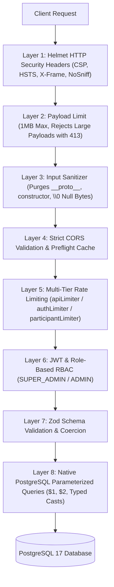

# GDG Ranchi DevFest 2026 — Participant & Game Management Backend

[](https://nodejs.org)
[](https://www.typescriptlang.org/)
[-336791.svg>)](https://www.postgresql.org/)
[-47A248.svg>)](https://www.mongodb.com/)
[](https://helmetjs.github.io/)
[](https://zod.dev)
[-success.svg>)](file:///home/abhishek-nexgen-dev/Desktop/Danger%20Zone/Devfest-Game/tests)
[](https://pnpm.io/)

Production-grade, highly secure backend system engineered for **GDG Ranchi DevFest 2026**. Manages **Admin & Super Admin authentication, participant registrations (`ticket_id`, `primary_language[]`), games management (`games` table), participant game progress & scores (`games` JSONB array with foreign-key validation), total points auto-calculation (`total_points`), certificate claims (`is_certificate_claim`), and leaderboards**.

Built with **Node.js, TypeScript, Express, Zod, and PostgreSQL (`pg` Pool)** using direct parameterized SQL queries (`pg.query(...)`), multi-tier rate limiting, advanced Helmet security headers, prototype pollution protection, and PL/pgSQL database triggers.

---

## 📑 Table of Contents

- [📚 Documentation Hub & Quick Links](#-documentation-hub--quick-links)
- [🛡️ 100% Security Architecture & Defenses](#️-100-security-architecture--defenses)
  - [1. Multi-Tier Rate Limiting Engine](#1-multi-tier-rate-limiting-engine)
  - [2. Advanced Helmet Security Headers](#2-advanced-helmet-security-headers)
  - [3. Complete SQL Injection Immunity (Parameterized SQL)](#3-complete-sql-injection-immunity-parameterized-sql)
  - [4. Prototype Pollution & Input Sanitization](#4-prototype-pollution--input-sanitization)
  - [5. Payload Size & DoS Protection](#5-payload-size--dos-protection)
  - [6. Session Cryptography & Cookie Hardening](#6-session-cryptography--cookie-hardening)
- [🏛️ System Architecture](#️-system-architecture)
- [📡 Complete REST API Catalog](#-complete-rest-api-catalog)
  - [1. Authentication & Admin Management](#1-authentication--admin-management)
  - [2. Games Management](#2-games-management)
  - [3. Participants Management](#3-participants-management)
  - [4. System & Health Endpoints](#4-system--health-endpoints)
- [🗄️ Database Schema & Triggers Blueprint](#️-database-schema--triggers-blueprint)
- [📂 Project Directory Structure](#-project-directory-structure)
- [⚡ Quick Start & Development](#-quick-start--development)
- [🧪 Test Suite Verification](#-test-suite-verification)
- [📄 License](#-license)

---

## 📚 Documentation Hub & Quick Links

All system specifications and developer guides are interlinked below. Click on any document to view complete schemas, payload structures, and cURL commands:

| Document                    | Description                                                                                     | Direct Link                                                    |
| :-------------------------- | :---------------------------------------------------------------------------------------------- | :------------------------------------------------------------- |
| **Authentication API Spec** | Complete reference for Super Admin seeding, login, admin creation, tokens, and cookie handling. | [AuthDoc.md](src/api/v1/auth/AuthDoc.md)                       |
| **Games API Spec**          | Complete reference for game creation, lifecycle updates, activation, closing, and queries.      | [GameDoc.md](src/api/v1/games/GameDoc.md)                      |
| **Participants API Spec**   | Complete reference for attendee registration, `primary_language[]`, and `games` progress array. | [ParticipantDoc.md](src/api/v1/participants/ParticipantDoc.md) |
| **Documentation Index**     | Central index and sitemap for all documentation files.                                          | [doc/README.md](doc/README.md)                                 |
| **Implementation Plan**     | End-to-end system blueprint, phase checklist, architectural decisions, and schema triggers.     | [implementation-plan.md](doc/implementation-plan.md)           |
| **AI Coding Guidelines**    | Exhaustive rules, design invariants, coding patterns, and guardrails for AI coding assistants.  | [ai-instructions.md](doc/ai-instructions.md)                   |

---

## 🛡️ 100% Security Architecture & Defenses

This backend implements a defense-in-depth security model to safeguard user credentials, attendee personal data, game competition integrity, and host server resources.



### 1. Multi-Tier Rate Limiting Engine

Implemented in [`src/middleware/rateLimiter.ts`](src/middleware/rateLimiter.ts) using `express-rate-limit`:

- **`apiLimiter` (Global API Defense)**:
  - Protects all `/api/v1` routes from distributed denial-of-service (DDoS) and aggressive web scraping.
  - Limit: **300 requests per 15 minutes** in production (**2000** in development).
- **`authLimiter` (Brute-Force & Credential Stuffing Defense)**:
  - Applied to sensitive authentication endpoints (`/auth/login`, `/init-admin`, `/change-password`, `/add-admin`).
  - Limits password guessing, dictionary attacks, and admin privilege escalation attempts.
  - Limit: **10 attempts per 15 minutes** in production (**100** in development).
- **`participantLimiter` (Registration Flooding Defense)**:
  - Applied to public attendee registration (`POST /api/v1/participants`, `POST /api/v1/participant/create`).
  - Prevents automated ticket bots from consuming ticket quotas or filling the database with bogus records.
  - Limit: **30 registrations per 15 minutes** in production (**200** in development).
- **Automated Test Friendly**: Automatically skipped when `NODE_ENV === "test"` so continuous integration and test suites execute without hitting rate limits.
- **RFC Standard Compliance**: Returns standard `RateLimit-*` headers and a structured JSON 429 response:
  ```json
  {
    "success": false,
    "status": false,
    "message": "Too many requests from this IP address. Please try again after 15 minutes.",
    "error": { "code": "RATE_LIMIT_EXCEEDED", "retryAfter": "15 minutes" },
    "data": null
  }
  ```

### 2. Advanced Helmet Security Headers

Configured in [`src/app.ts`](src/app.ts) using `helmet`:

- **`Content-Security-Policy (CSP)`**: Restricts default sources to `'self'`, disables unauthorized scripts, disallows `<object>` embeddings, and disallows `<iframe>` framing (`frame-src: 'none'`).
- **`X-Frame-Options: DENY`**: Protects against UI redressing and Clickjacking attacks.
- **`X-Content-Type-Options: nosniff`**: Prevents MIME-type sniffing vulnerabilities.
- **`Strict-Transport-Security (HSTS)`**: Enforces HTTPS connections for 1 year (`maxAge: 31536000`), applies to all subdomains, and enables HSTS preload.
- **`Referrer-Policy: strict-origin-when-cross-origin`**: Prevents leakage of sensitive request paths and token URLs in the `Referer` header.
- **`X-Powered-By Disabled`**: Explicitly stripped via `app.disable("x-powered-by")` and `helmet.hidePoweredBy()` to eliminate technology fingerprinting.

### 3. Complete SQL Injection Immunity (Parameterized SQL)

- **100% Parameterized Queries**: Every database query across [`AuthUtils.ts`](src/api/v1/auth/AuthUtils.ts), [`Games.Utils.ts`](src/api/v1/games/Games.Utils.ts), and [`Participants.Utils.ts`](src/api/v1/participants/Participants.Utils.ts) strictly uses parameterized placeholders (`$1`, `$2`, ..., `$12`).
- **Protocol-Level Separation**: User inputs and SQL commands are transmitted to PostgreSQL as distinct protocol messages. PostgreSQL compiles the SQL execution plan before binding parameters, rendering string injection mathematically impossible.
- **Explicit Parameter Type Casting**: Queries utilize explicit PostgreSQL data type casting (e.g., `$1::varchar`, `$6::timestamptz`, `$8::text[]`, `$9::jsonb`, `$9::bigint`) to eliminate type inference exploits and prepared statement caching issues.
- **Zero ORM Overhead**: No Prisma, Sequelize, TypeORM, or Mongoose vulnerabilities. Direct `pg` Pool parameterized statements only.

### 4. Prototype Pollution & Input Sanitization

Implemented in [`src/middleware/security.middleware.ts`](src/middleware/security.middleware.ts):

- Recursively inspects every incoming `req.body`, `req.query`, and `req.params`.
- Automatically strips dangerous prototype pollution keys: `__proto__`, `constructor`, and `prototype`.
- Strips null-byte characters (`\0`) to prevent null-byte poisoning and string termination bypasses.
- Strict Zod schemas coerce, trim, lowercase, and validate strings and arrays before reaching business services.

### 5. Payload Size & DoS Protection

- Request bodies are strictly capped at **1MB** (`express.json({ limit: "1mb" })`, `express.urlencoded({ limit: "1mb" })`).
- Requests exceeding the limit are rejected immediately with HTTP `413 Payload Too Large`, preventing memory exhaustion attacks from massive JSON bodies.

### 6. Session Cryptography & Cookie Hardening

- **Single Super Admin Invariant**: Seeded once via `POST /api/v1/init-admin`; attempts to create multiple Super Admins throw a duplicate error.
- **Password Hashing**: Industry-standard **Bcrypt** with 10 salt rounds and **Argon2** verification.
- **JWT Authentication**: Cryptographically signed with HMAC SHA-256 (`JWT_SECRET`) and a configurable expiration (`7d`).
- **HTTP-Only Cookies**: JWT tokens set in cookies use `httpOnly: true` (preventing XSS access), `secure: true` in production (enforcing HTTPS transmission), and `sameSite: "lax"` (mitigating CSRF attacks).

---

## 🏛️ System Architecture

- **Primary Relational Store**: **PostgreSQL 17** via `pg` (`Pool` in [`src/core/database/postgres.ts`](src/core/database/postgres.ts)).
  - Auto-detects and connects to local PostgreSQL unix sockets or TCP ports.
  - Automatically provisions `devfest_game_db` if not found.
  - Supports cloud providers (e.g. Supabase) via SSL-enabled `DATABASE_URL`.
- **Secondary Document Store**: **MongoDB 8.3.8** with native `mongosh` support via helper scripts.
- **Global Schema Runner**: [`src/core/database/schema.ts`](src/core/database/schema.ts) (`initSchemas`) idempotently provisions schemas and PL/pgSQL triggers in order:
  1. `AuthSchema()` (`users` table)
  2. `Games_Schema()` (`games` table)
  3. `Participants_Schema()` (`participants` table + FK triggers)
- **Standardized Response Envelope**: All API endpoints return a unified JSON payload:
  ```json
  {
    "success": true,
    "status": true,
    "message": "Operation completed successfully.",
    "data": { ... }
  }
  ```

---

## 📡 Complete REST API Catalog

### 1. Authentication & Admin Management

Detailed documentation with cURL examples: **[AuthDoc.md](src/api/v1/auth/AuthDoc.md)**

| Method | Endpoint                  | Description                                                | Access            | Rate Limit |
| :----- | :------------------------ | :--------------------------------------------------------- | :---------------- | :--------- |
| `POST` | `/api/v1/init-admin`      | Seed the single `SUPER_ADMIN` account from `.env`          | Public (One-time) | 10 / 15m   |
| `POST` | `/api/v1/auth/login`      | Sign in for `SUPER_ADMIN` or `ADMIN`                       | Public            | 10 / 15m   |
| `POST` | `/api/v1/add-admin`       | Create a new `ADMIN` account (`name`, `email`, `password`) | `SUPER_ADMIN`     | 10 / 15m   |
| `GET`  | `/api/v1/me`              | Fetch authenticated admin profile                          | Authenticated     | 300 / 15m  |
| `POST` | `/api/v1/change-password` | Update current admin account password                      | Authenticated     | 10 / 15m   |
| `GET`  | `/api/v1/verify`          | Verify current JWT token / cookie validity                 | Authenticated     | 300 / 15m  |
| `POST` | `/api/v1/logout`          | Clear authentication cookie and terminate session          | Public            | 300 / 15m  |

### 2. Games Management

Detailed documentation with cURL examples: **[GameDoc.md](src/api/v1/games/GameDoc.md)**

| Method          | Endpoint                                                     | Description                                               | Access                  | Rate Limit |
| :-------------- | :----------------------------------------------------------- | :-------------------------------------------------------- | :---------------------- | :--------- |
| `POST`          | `/api/v1/game/create` _(alias: `/games`, `/games/create`)_   | Create a new game (`game_name`, `start_time`, `end_time`) | `SUPER_ADMIN` & `ADMIN` | 300 / 15m  |
| `GET`           | `/api/v1/game/get` _(alias: `/games`, `/games/get`)_         | List all games ordered by `created_at DESC`               | Public                  | 300 / 15m  |
| `GET`           | `/api/v1/game/:id` _(alias: `/games/:id`, `/game/get/:id`)_  | Fetch a single game by numeric `id`                       | Public                  | 300 / 15m  |
| `GET`           | `/api/v1/game/name/:name` _(alias: `/games/name/:name`)_     | Fetch a single game by `game_name`                        | Public                  | 300 / 15m  |
| `PATCH` / `PUT` | `/api/v1/game/:id` _(alias: `/games/:id`)_                   | Update game attributes with timeframe validation          | `SUPER_ADMIN` & `ADMIN` | 300 / 15m  |
| `PATCH`         | `/api/v1/game/:id/activate` _(alias: `/games/:id/activate`)_ | Activate a game (sets status to `ACTIVE`)                 | `SUPER_ADMIN` & `ADMIN` | 300 / 15m  |
| `PATCH`         | `/api/v1/game/:id/close` _(alias: `/games/:id/close`)_       | Close a game (sets status to `CLOSED`)                    | `SUPER_ADMIN` & `ADMIN` | 300 / 15m  |

### 3. Participants Management

Detailed documentation with cURL examples: **[ParticipantDoc.md](src/api/v1/participants/ParticipantDoc.md)**

| Method  | Endpoint                                | Description                                                                                                                                                                                                                                   | Access                               | Rate Limit |
| :------ | :-------------------------------------- | :-------------------------------------------------------------------------------------------------------------------------------------------------------------------------------------------------------------------------------------------- | :----------------------------------- | :--------- |
| `POST`  | `/api/v1/participant/create`            | Register new attendee profile (`ticket_id`, `primary_language[]`)                                                                                                                                                                             | Public (Anyone)                      | 30 / 15m   |
| `GET`   | `/api/v1/participants/get`              | List all participants ordered by `total_points DESC`                                                                                                                                                                                          | Public                               | 300 / 15m  |
| `GET`   | `/api/v1/participant/:ticketId`         | Retrieve a participant profile by `ticket_id`                                                                                                                                                                                                 | Public                               | 300 / 15m  |
| `POST`  | `/api/v1/participant/join-game`         | **Public Join Game**: Takes `email`, `ticket_id`, and `game_id` directly in `req.body`. Backend verifies participant by email & ticket, resolves `game_name` from `games` table, and defaults `isCompleted: false` and `Total_game_point: 0`. | **Public** (`optionalAuth`)          | 300 / 15m  |
| `PUT`   | `/api/v1/participant/:ticketId`         | **Admin Profile Update**: Updates attendee profile information directly based on `ticket_id` via PostgreSQL without updating `games` (games are managed strictly via `/join-game`).                                                           | **Admins** (`SUPER_ADMIN` / `ADMIN`) | 300 / 15m  |
| `PATCH` | `/api/v1/participants/update/game-score` | **Admin Game Score Update**: Updates single game score (`Total_game_point`) via query parameters `ticket_id` & `game_id`, and automatically recalculates `total_points` across all games.                                                      | **Admins** (`SUPER_ADMIN` / `ADMIN`) | 300 / 15m  |

### 4. System & Health Endpoints

| Method | Endpoint       | Description                                                              | Access |
| :----- | :------------- | :----------------------------------------------------------------------- | :----- |
| `GET`  | `/health`      | Health check returning service status, uptime timestamp, and environment | Public |
| `GET`  | `/`            | Redirects directly to `/health`                                          | Public |
| `GET`  | `/api/v1/docs` | Returns API metadata, version, and documentation references              | Public |

---

## 🗄️ Database Schema & Triggers Blueprint

### 1. `users` Table (Admins & Super Admin)

```sql
CREATE TABLE IF NOT EXISTS users (
  id VARCHAR(128) PRIMARY KEY,
  name VARCHAR(100) NOT NULL,
  email VARCHAR(255) NOT NULL UNIQUE,
  password_hash VARCHAR(255) NOT NULL,
  role VARCHAR(32) NOT NULL DEFAULT 'ADMIN' CHECK (role IN ('SUPER_ADMIN', 'ADMIN')),
  status VARCHAR(32) NOT NULL DEFAULT 'ACTIVE' CHECK (status IN ('ACTIVE', 'DISABLED')),
  created_at TIMESTAMPTZ NOT NULL DEFAULT NOW(),
  updated_at TIMESTAMPTZ NOT NULL DEFAULT NOW()
);
```

### 2. `games` Table

```sql
CREATE TABLE IF NOT EXISTS games (
  id BIGINT GENERATED ALWAYS AS IDENTITY PRIMARY KEY,
  game_name VARCHAR(150) NOT NULL UNIQUE,
  description TEXT,
  max_score INTEGER NOT NULL DEFAULT 100 CHECK (max_score >= 0),
  registrations INTEGER NOT NULL DEFAULT 0 CHECK (registrations >= 0),
  submissions INTEGER NOT NULL DEFAULT 0 CHECK (submissions >= 0),
  start_time TIMESTAMPTZ NOT NULL,
  end_time TIMESTAMPTZ NOT NULL,
  status VARCHAR(32) NOT NULL DEFAULT 'UPCOMING' CHECK (status IN ('UPCOMING', 'ACTIVE', 'CLOSED')),
  created_at TIMESTAMPTZ NOT NULL DEFAULT NOW(),
  updated_at TIMESTAMPTZ NOT NULL DEFAULT NOW(),
  CHECK (end_time > start_time)
);
```

### 3. `participants` Table & Trigger

```sql
CREATE TABLE IF NOT EXISTS participants (
  id BIGINT GENERATED ALWAYS AS IDENTITY PRIMARY KEY,
  ticket_id VARCHAR(32) NOT NULL UNIQUE,
  name VARCHAR(150) NOT NULL,
  email VARCHAR(255) NOT NULL,
  mobile_number VARCHAR(20) NOT NULL,
  social_link TEXT NOT NULL,
  profile_image TEXT,
  location VARCHAR(150) NOT NULL,
  github_url TEXT,
  primary_language TEXT[] NOT NULL,
  games JSONB NOT NULL DEFAULT '[]'::jsonb,
  total_points INTEGER NOT NULL DEFAULT 0 CHECK (total_points >= 0),
  is_certificate_claim BOOLEAN NOT NULL DEFAULT FALSE,
  created_at TIMESTAMPTZ NOT NULL DEFAULT NOW(),
  updated_at TIMESTAMPTZ NOT NULL DEFAULT NOW()
);

-- Trigger: Enforces game_id foreign key validation against games(id), auto-looks up game_name, and auto-sums total_points
CREATE TRIGGER trigger_participants_games_fk
  BEFORE INSERT OR UPDATE OF games ON participants
  FOR EACH ROW
  EXECUTE FUNCTION validate_and_sync_participant_games();
```

---

## 📂 Project Directory Structure

```text
├── .env                             # Environment variables
├── package.json                     # Dependencies, scripts, and build tasks
├── tsconfig.json                    # TypeScript strict mode configuration
├── jest.config.ts                   # Jest testing configuration
├── doc/
│   ├── README.md                    # Documentation index
│   ├── implementation-plan.md       # Detailed system roadmap and architecture plan
│   └── ai-instructions.md           # Guidelines and invariants for AI assistants
├── scripts/
│   ├── start-mongo.sh               # Helper script to launch MongoDB daemon
│   ├── stop-mongo.sh                # Helper script to terminate MongoDB daemon
│   └── mongosh.sh                   # Helper script to connect via mongosh
├── src/
│   ├── app.ts                       # Express setup, Helmet, CORS, Rate Limit, Error Handler
│   ├── server.ts                    # Server entry point (connectDatabase -> initSchemas -> listen)
│   ├── api/v1/
│   │   ├── auth/                    # Authentication module (users table)
│   │   │   ├── Auth.type.ts
│   │   │   ├── Auth.schema.ts
│   │   │   ├── Auth.validation.ts
│   │   │   ├── AuthUtils.ts
│   │   │   ├── Auth.Service.ts
│   │   │   ├── Auth.controller.ts
│   │   │   ├── Auth.router.ts
│   │   │   ├── auth.constants.ts
│   │   │   └── AuthDoc.md           # Authentication API Spec
│   │   ├── participants/            # Participant registration & progress module
│   │   │   ├── Participants.type.ts
│   │   │   ├── Participants.Schema.ts
│   │   │   ├── Participants.validation.ts
│   │   │   ├── Participants.Utils.ts
│   │   │   ├── Participants.Service.ts
│   │   │   ├── Participants.controller.ts
│   │   │   ├── Participant.routes.ts
│   │   │   ├── participant.constants.ts
│   │   │   └── ParticipantDoc.md    # Participants API Spec
│   │   └── games/                   # Games management module
│   │       ├── Game.Type.ts
│   │       ├── Games.Schema.ts
│   │       ├── Games.validation.ts
│   │       ├── Games.Utils.ts
│   │       ├── Game.Service.ts
│   │       ├── Games.Controller.ts
│   │       ├── Games.Routes.ts
│   │       ├── game.constants.ts
│   │       └── GameDoc.md           # Games API Spec
│   ├── constants/
│   │   ├── collections.ts           # Compile-time PostgreSQL table names
│   │   ├── env.constant.ts          # Zod-validated environment configuration
│   │   └── error.constant.ts        # Centralized system error constants
│   ├── core/
│   │   ├── database/
│   │   │   ├── postgres.ts          # PostgreSQL Pool & connection lifecycle
│   │   │   └── schema.ts            # Global schema initializer (initSchemas)
│   │   └── logger/
│   │       └── logger.ts            # Structured application logging
│   ├── middleware/
│   │   ├── auth.middleware.ts       # JWT verification & RBAC authorization
│   │   ├── rateLimiter.ts           # Global, Auth, and Participant rate limiters
│   │   └── security.middleware.ts   # Prototype pollution & null-byte sanitization
│   ├── routes/
│   │   └── routes.ts                # Main API v1 routing orchestrator
│   └── utils/
│       └── SendResponse.ts          # Standardized response envelopes
└── tests/
    ├── auth.test.ts                 # 21 Auth unit & PostgreSQL integration tests
    ├── game.test.ts                 # 21 Games CRUD & lifecycle integration tests
    └── security.test.ts             # 12 Helmet, SQLi, Prototype Pollution, & DoS tests
```

---

## ⚡ Quick Start & Development

### 1. Install Dependencies

```bash
pnpm install
```

### 2. Configure Environment Variables (`.env`)

```env
# Server Configuration
PORT=3000
NODE_ENV=development
API_PREFIX=/api/v1
CORS_ORIGIN=*

# PostgreSQL Configuration (Local or Remote / Supabase)
DB_USER=postgres
DB_HOST=/tmp
DB_NAME=devfest_game_db
DB_PASSWORD=postgres
DB_PORT=5432

# MongoDB Configuration
MONGO_PORT=27018
MONGO_DB_NAME=devfest_game_db
MONGO_URI=mongodb://%2Ftmp%2Fmongodb-27018.sock/devfest_game_db

# JWT Security
JWT_SECRET=devfest_super_secret_jwt_key_2026
JWT_EXPIRES_IN=7d

# Initial Super Admin Seed Credentials
INITIAL_ADMIN_EMAIL=admin@gdgranchi.in
INITIAL_ADMIN_PASSWORD=AdminPass@2026
INITIAL_ADMIN_NAME=GDG Ranchi Super Admin
```

### 3. Start PostgreSQL Server

```bash
# If running local PostgreSQL in cluster:
/usr/lib/postgresql/17/bin/pg_ctl -D .postgres_data -l /tmp/pg.log -o "-k /tmp -h ''" start
```

### 4. Start Development Server

```bash
pnpm run dev
```

### 5. Type-Check & Build

```bash
pnpm build
```

---

## 🧪 Test Suite Verification

The repository includes comprehensive automated test suites covering unit logic, database transactions, API integration, and security penetration scenarios:

```bash
# Run all test suites sequentially:
npm test

# Run security test suite:
npm test tests/security.test.ts

# Run game integration tests:
npm test tests/game.test.ts

# Run auth integration tests:
npm test tests/auth.test.ts
```

### Test Coverage Results

```text
Test Suites: 3 passed, 3 total
Tests:       54 passed, 54 total (100% Passing)
  ✓ tests/auth.test.ts       (21 / 21 passed)
  ✓ tests/game.test.ts       (21 / 21 passed)
  ✓ tests/security.test.ts   (12 / 12 passed)
```

---

## 📄 License

Developed for **GDG Ranchi DevFest 2026**. Released under the [ISC License](LICENSE).
